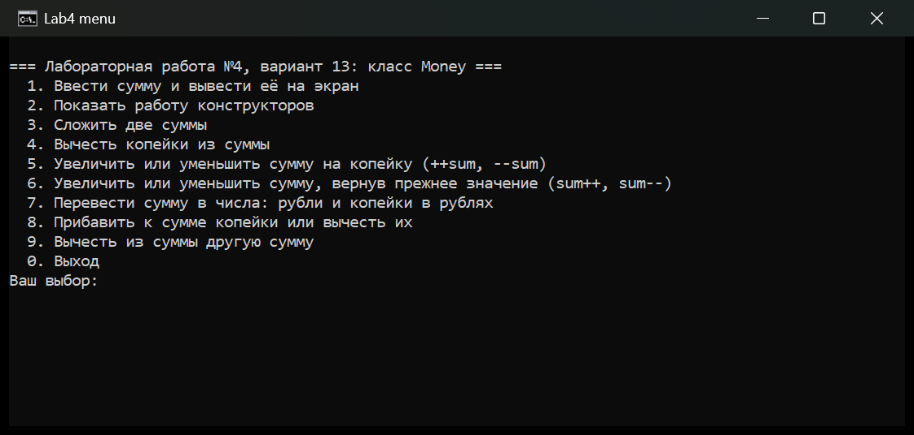
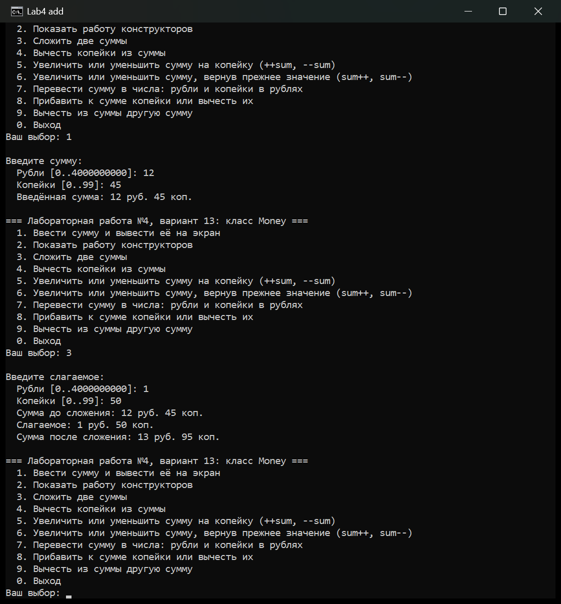
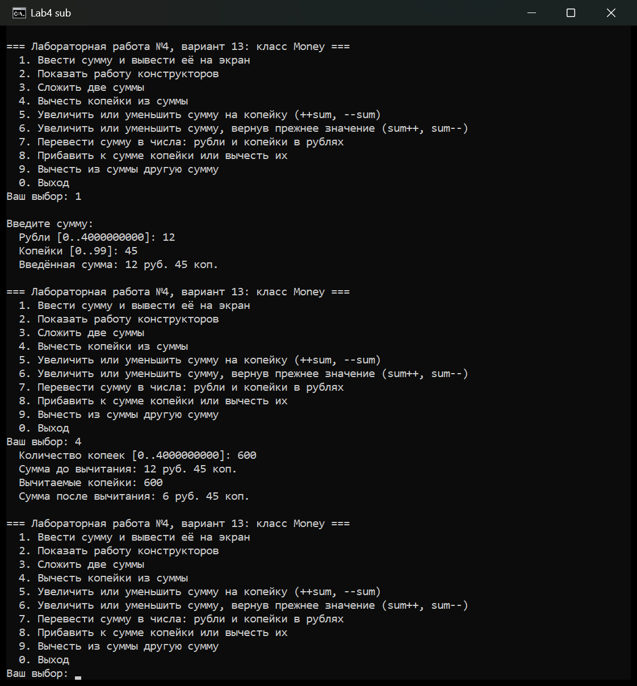
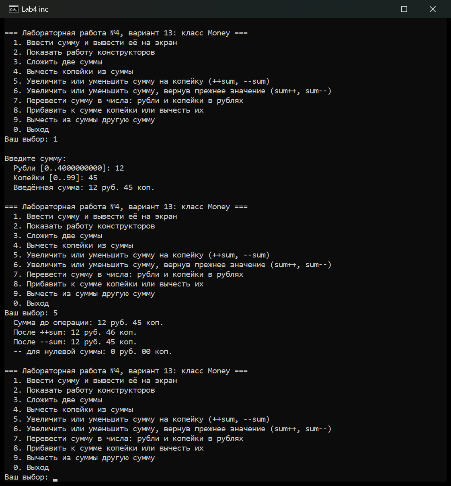
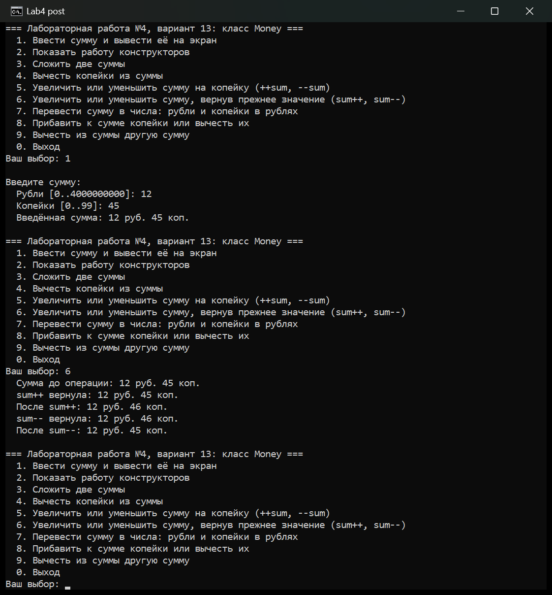
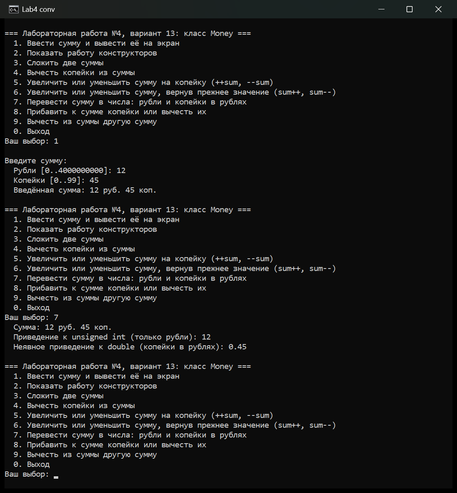
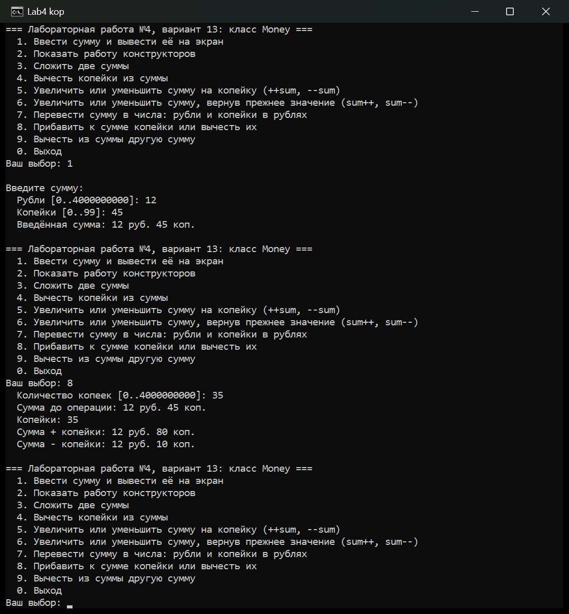

# Сальников Михаил Группа ЛА-2 Лабораторная №4

# Меню программы

```
=== Лабораторная работа №4, вариант 13: класс Money ===
  1. Ввести сумму и вывести её на экран
  2. Показать работу конструкторов
  3. Сложить две суммы
  4. Вычесть копейки из суммы
  5. Увеличить или уменьшить сумму на копейку (++sum, --sum)
  6. Увеличить или уменьшить сумму, вернув прежнее значение (sum++, sum--)
  7. Перевести сумму в числа: рубли и копейки в рублях
  8. Прибавить к сумме копейки или вычесть их
  9. Вычесть из суммы другую сумму
  0. Выход
```

Пункты 3–9 вызывают по одной перегруженной операции класса `Money`, пункт 2 показывает работу всех конструкторов. Все исходные данные вводятся с клавиатуры, каждая строка проверяется на корректность: программа принимает только целое число из указанного диапазона и просит повторить ввод при ошибке.



# Задание 1

## Задача 13

### Текст задачи

В задании 1 реализовать определение класса (поля, свойства, конструкторы (не менее трех), перегрузку оператора вывода для вывода полей, заданный метод согласно варианту). Протестировать все методы, включая конструкторы, все исходные данные вводятся с клавиатуры, не забывайте проверять данные на корректность.

В главной функции main показать работу всех функций с дружественным интерфейсом.

Вариант 13:

| № | Название класса | Поля | Методы |
|---|-----------------|------|--------|
| 13 | Money | unsigned int rubles, short int kopeks | Вычитание копеек (unsigned int) из объекта типа Money(учесть, что денежная величина не может быть меньше 0). Результат должен быть типа Money. |

### Алгоритм решения
1. Поля `rubles_` и `kopeks_` класса `Money` хранят сумму; после любой операции копейки приводятся к диапазону от 0 до 99.
2. Реализованы три конструктора: по умолчанию (`0 руб. 00 коп.`), `Money(рубли)` и `Money(рубли, копейки)`, а также копирующий конструктор и оператор присваивания.
3. Свойства `rubles()` и `kopeks()` дают доступ к полям, сеттеры `set_rubles()` и `set_kopeks()` меняют сумму с нормализацией копеек.
4. Вся арифметика ведётся в копейках (`int64_t`): `rubles_ * 100 + kopeks_`, поэтому переносы через рубль считаются автоматически.
5. Метод `SubtractKopeks(unsigned int kopeks)` вычитает копейки из общей суммы; если результат получился отрицательным, он приравнивается к нулю — денежная сумма не может быть меньше 0.
6. Оператор `operator+` складывает две суммы в копейках и нормализует результат; при переполнении сумма ограничивается максимально допустимой.
7. Перегруженный оператор вывода `operator<<` печатает сумму в виде `12 руб. 45 коп.` и используется во всех пунктах меню.

### Тестирование

| Входные данные (сумма, копейки) | Ожидаемый результат |
|---------------------------------|---------------------|
| 12 руб. 45 коп., 600            | 6 руб. 45 коп.      |
| 12 руб. 45 коп., 2000           | 0 руб. 00 коп.      |
| 0 руб. 00 коп., 5               | 0 руб. 00 коп.      |
| 12 руб. 45 коп., 0              | 12 руб. 45 коп.     |

Сложение двух сумм (оператор «+»):

| Входные данные (слагаемые) | Ожидаемый результат |
|----------------------------|---------------------|
| 12 руб. 45 коп. + 1 руб. 50 коп. | 13 руб. 95 коп. |
| 0 руб. 99 коп. + 0 руб. 01 коп.  | 1 руб. 00 коп.  |
| 0 руб. 00 коп. + 0 руб. 00 коп.  | 0 руб. 00 коп.  |

Сложение двух сумм:



Вычитание копеек из суммы:



# Задание 2

## Задача 13 (класс Money)

### Текст задачи

В задании 2 добавить к реализованному в первом задании классу указанные в варианте перегруженные операции.

Класс Money (вторая строка таблицы задания 2):

| № | Название класса | Методы |
|---|-----------------|--------|
| 2 | Money | Унарные операции:<br>++ добавление копейки к объекту типа Money<br>-- вычитание копейки из объекта типа Money<br>Операции приведения типа:<br>unsigned int (явная) – результатом является количество рублей (копейки отбрасываются);<br>double (неявная) – результатом является копейки, переведенные в рубли, целые рубли отбрасываются, результат &lt;1.<br>Бинарные операции:<br>+ Money m, беззнаковое целое число (копейки). Результат должен быть типа Money.<br>– Money m, беззнаковое целое число (копейки). Результат должен быть типа Money. |

### Алгоритм решения
1. `operator++` и `operator--` реализованы в префиксной и постфиксной формах. Префиксная форма меняет объект и возвращает ссылку на него, постфиксная возвращает предыдущее значение.
2. Увеличение и уменьшение выполняется через общую сумму в копейках; при `--` сумма не может стать отрицательной.
3. `explicit operator unsigned int()` возвращает поле `rubles_`, то есть количество полных рублей без копеек.
4. `operator double()` возвращает `kopeks_ / 100.0` — копейки, переведённые в рубли; целые рубли отбрасываются.
5. `operator+(unsigned int kopeks)` и `operator-(unsigned int kopeks)` прибавляют и вычитают копейки по тому же правилу, что и `SubtractKopeks`.

### Тестирование

| Операция | Входные данные | Ожидаемый результат |
|----------|----------------|---------------------|
| `++sum`  | 12 руб. 45 коп. | 12 руб. 46 коп. |
| `--sum`  | 0 руб. 00 коп.  | 0 руб. 00 коп.  |
| `sum++`  | 12 руб. 45 коп. | возвращает 12 руб. 45 коп., сумма 12 руб. 46 коп. |
| `sum--`  | 12 руб. 46 коп. | возвращает 12 руб. 46 коп., сумма 12 руб. 45 коп. |
| `unsigned int` | 12 руб. 45 коп. | 12 |
| `double` | 12 руб. 45 коп. | 0.45 |
| `sum + 35` | 12 руб. 45 коп. | 12 руб. 80 коп. |
| `sum - 35` | 12 руб. 45 коп. | 12 руб. 10 коп. |
| `sum - 2000` | 12 руб. 45 коп. | 0 руб. 00 коп. |

Префиксные операции `++sum` и `--sum`:



Постфиксные операции `sum++` и `sum--`:



Приведение к `unsigned int` и `double`:



Сложение и вычитание копеек:



# Состав проекта и сборка

| Файл | Содержимое |
|------|------------|
| `lab4/money.h` | объявление класса `Money` |
| `lab4/money.cc` | реализация конструкторов, методов и перегруженных операций |
| `lab4/main.cc` | меню, ввод данных с клавиатуры, проверка корректности ввода |
| `lab4/img/` | скриншоты работы программы |

Сборка из папки проекта:

```
cl /nologo /std:c++20 /EHsc /W4 /utf-8 /I. lab4\money.cc lab4\main.cc /Fe:lab4\money.exe
```

Код оформлен по Google C++ Style Guide: защита заголовка `LAB4_MONEY_H_`, пространство имён `lab4`, методы в `snake_case`, константы с префиксом `k`, отступ 2 пробела, строки не длиннее 80 символов, поля закрытые.
Отступления от руководства сделаны по требованию варианта: поля объявлены как `unsigned int` и `short int`, а приведение к `double` неявное (в стиле Google такие операторы делают `explicit`).
